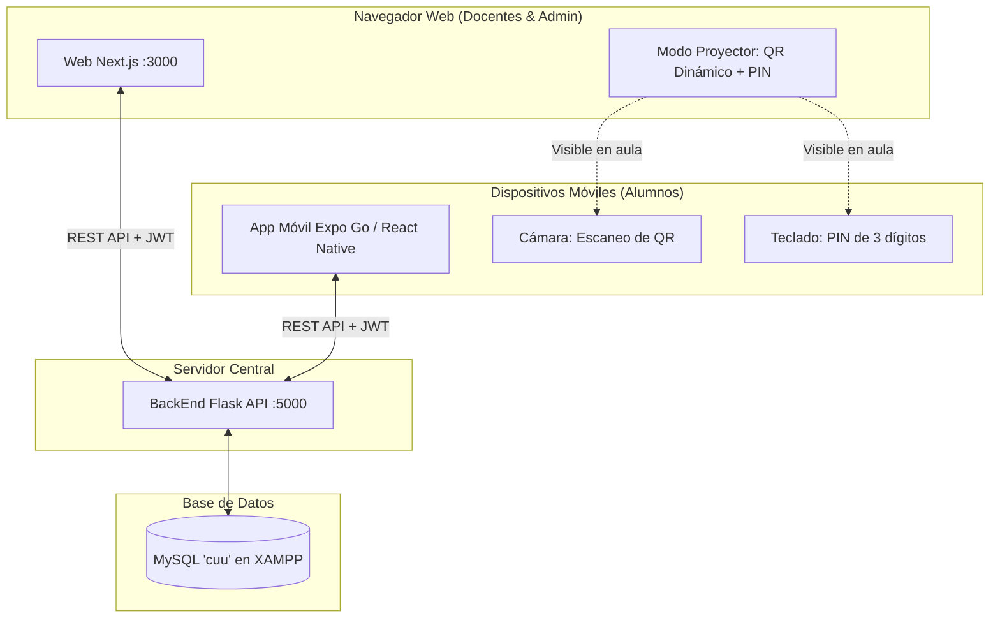

# 🎓 CheckU — Sistema Integral de Control de Asistencias Universitarias

> Plataforma universitaria integral para el registro, monitoreo y gestión de asistencias en tiempo real mediante **códigos QR dinámicos**, respaldo numérico por **PIN de 3 dígitos**, panel web docente/administrativo y aplicación móvil estudiantil.

---

## 📋 Tabla de Contenidos
1. [Arquitectura y Cómo Funciona](#-arquitectura-y-cómo-funciona)
2. [Estructura del Proyecto](#-estructura-del-proyecto)
3. [Requisitos Previos](#-requisitos-previos)
4. [Inicio Rápido (Todo en Uno)](#-inicio-rápido-todo-en-uno)
5. [Base de Datos y Migraciones](#-base-de-datos-y-migraciones)
6. [Módulo 1: BackEnd (API REST Flask)](#-módulo-1-backend-api-rest-flask)
7. [Módulo 2: Web (Portal Docente y Admin en Next.js)](#-módulo-2-web-portal-docente-y-admin-en-nextjs)
8. [Módulo 3: Móvil (App Estudiantil en React Native / Expo)](#-módulo-3-móvil-app-estudiantil-en-react-native--expo)
9. [Cuentas de Demostración (Credenciales)](#-cuentas-de-demostración-credenciales)
10. [Solución de Problemas Frecuentes](#-solución-de-problemas-frecuentes)
11. [CI Pipeline (GitHub Actions)](#-ci-pipeline-github-actions)

---

## 🧠 Arquitectura y Cómo Funciona

CheckU sincroniza tres capas principales para automatizar el pase de lista universitario sin fricción:



### 🔄 Flujo del Pase de Lista en Clase
1. **Inicio de sesión docente**: El profesor entra al portal web (`http://localhost:3000`) y selecciona su grupo.
2. **Generación de sesión QR**: El profesor abre el **Modo Proyector** en la pantalla del aula. El Backend genera un token criptográfico temporal y un **PIN aleatorio de 3 dígitos**.
3. **Pase de lista del alumno**:
   - El alumno abre la app móvil e inicia sesión con su matrícula.
   - **Opción A (Principal)**: Escanea con la cámara del teléfono el QR proyectado.
   - **Opción B (Respaldo)**: Si el alumno está lejos o la cámara falla, introduce el PIN de 3 dígitos visible en la pantalla.
4. **Validación inmediata**: El Backend comprueba que el alumno esté inscrito en el grupo, que la sesión esté vigente y que no haya registrado asistencia previamente.
5. **Feed en tiempo real**: La pantalla del proyector en la Web muestra instantáneamente el nombre del alumno, lanza una animación con confetti y actualiza los porcentajes del grupo.
6. **Justificantes de inasistencia**: Si un alumno falta justificadamente, envía su comprobante (PDF/imagen) desde la app; el docente o admin lo revisa en la Web y actualiza el estado a `JUSTIFICADA`.

---

## 📁 Estructura del Proyecto

```text
D:\CheckU\
├── BackEnd/                    # API REST desarrollada en Python Flask
│   ├── controllers/            # Controladores de rutas (auth, qr, profesor, alumno, etc.)
│   ├── models/                 # Modelos de base de datos SQLAlchemy
│   ├── migrations/             # Migraciones de esquema con Alembic
│   ├── seeds/                  # Sembrador de datos demo (seeder.py)
│   ├── uploads/                # Archivos y comprobantes de justificantes
│   ├── config.py               # Configuración centralizada de BD y JWT
│   ├── app.py                  # Fábrica de la aplicación Flask
│   ├── run.py                  # Entrypoint del servidor
│   └── requirements.txt        # Dependencias de Python
│
├── web/                        # Panel Web Docente y Admin (Next.js 14 + Tailwind CSS)
│   ├── src/pages/              # Vistas: login, dashboard, grupos, proyector, admin, reportes
│   ├── src/components/         # Layout, Navbar, Sidebar, Modales
│   ├── src/services/api.ts     # Cliente Axios y llamadas a endpoints
│   └── package.json            # Dependencias de Node.js
│
├── MovilExpo/                  # App Móvil recomendada (React Native con Expo SDK)
│   ├── src/screens/            # Pantallas: Login, AlumnoHome, DocenteHome
│   ├── src/components/         # Escáner de cámara (QRScannerModal), FeedbackModal
│   ├── src/services/api.ts     # Detección dinámica de IP del host y peticiones HTTP
│   └── app.json                # Configuración de Expo y permisos de cámara
│
├── Movil/                      # Versión alternativa React Native CLI nativo (ADB)
│
├── iniciar_todo.bat            # Script para arrancar BackEnd, Web y Móvil simultáneamente
├── iniciar_backend.bat         # Arranca únicamente el BackEnd (Puerto 5000)
├── iniciar_web.bat             # Arranca únicamente el portal Web (Puerto 3000)
├── iniciar_movil_expo.bat      # Arranca el servidor Metro de Expo Go
├── migrar_bd.bat               # Asistente interactivo de migraciones de base de datos
└── MIGRACIONES_MYSQL.md        # Documentación de esquemas y tablas MySQL
```

---

## ⚙️ Requisitos Previos

Asegúrate de tener instaladas las siguientes herramientas en tu computadora:

- **Node.js**: Versión `18.x` o superior ([Descargar](https://nodejs.org/)).
- **Python**: Versión `3.10` a `3.12` ([Descargar](https://www.python.org/)).
- **XAMPP / MySQL**: Servidor MySQL corriendo en el puerto estándar `3306` ([Descargar XAMPP](https://www.apachefriends.org/)).
- **Expo Go (en tu teléfono celular)**: Aplicación gratuita disponible en Google Play Store (Android) y App Store (iOS).
- **Git**: (Opcional) Para clonado y control de versiones.

---

## 🚀 Inicio Rápido (Todo en Uno)

La forma más rápida de ejecutar todo el ecosistema es:

1. **Abre XAMPP** e inicia el módulo de **MySQL**.
2. Verifica que exista la base de datos `cuu` (se crea automáticamente o puedes crearla en `phpMyAdmin`: `http://localhost/phpmyadmin`).
3. En la raíz del proyecto (`D:\CheckU`), ejecuta con doble clic:
   ```cmd
   iniciar_todo.bat
   ```
4. Se abrirán 3 ventanas de terminal independientes:
   - **BackEnd**: escuchando en `http://localhost:5000`
   - **Web**: disponible en tu navegador en `http://localhost:3000`
   - **Móvil Expo**: mostrando el código QR de Metro en pantalla para escanear con la app **Expo Go** de tu teléfono.

---

## 🗄️ Base de Datos y Migraciones

La base de datos oficial se llama **`cuu`** y se almacena en **MySQL**.

### Tablas Principales
| Tabla | Descripción |
|---|---|
| `administradores` | Cuentas con privilegios de gestión institucional y docentes. |
| `profesores` | Plantilla docente con matrícula y contraseña encriptada. |
| `alumnos` | Estudiantes universitarios con matrícula institucional. |
| `grupos` | Materias/aulas asignadas a docentes con horarios y fechas de cuatrimestre. |
| `grupo_alumno` | Tabla intermedia de inscripción de alumnos en grupos. |
| `sesiones_qr` | Sesiones de pase de lista activas/históricas con token QR y PIN. |
| `asistencias` | Registro del pase (`PRESENTE`, `RETARDO`, `FALTA`, `JUSTIFICADA`). |
| `justificantes` | Solicitudes de justificación con archivos adjuntos y dictamen. |

### Asistente Interactivo de Migraciones
En la raíz de CheckU dispones del script:
```cmd
migrar_bd.bat
```
Opciones disponibles en el menú:
- `[1]` Generar migración tras modificar modelos Python (`flask db migrate`).
- `[2]` Aplicar cambios pendientes a MySQL `cuu` (`flask db upgrade`).
- `[3]` Proceso completo (Generar y aplicar).
- `[4]` Sembrar datos demo iniciales (`flask seed`).
- `[5]` Comprobar tablas activas en MySQL.

---

## 🐍 Módulo 1: BackEnd (API REST Flask)

### ¿Cómo Funciona?
El backend está construido con **Flask 3.0** y una arquitectura modular organizada en Blueprints y controladores:
- **Autenticación multifuncional (`/api/auth`)**: Emisión y validación de tokens seguros **JWT**. Detecta el rol (`admin`, `profesor`, `alumno`) y restringe a los alumnos el acceso al panel web.
- **Motor de Código QR (`/api/qr`)**: Genera el token único con timestamp, calcula el PIN de 3 dígitos y devuelve el código QR renderizado en **Base64** para mostrarlo sin almacenar imágenes basura en disco.
- **Gestión Docente (`/api/profesor`)**: CRUD de grupos, asignación de alumnos, visualización de métricas de asistencia y aprobación/rechazo de justificantes.
- **Administración (`/api/admin`)**: Registro y control de profesores y estadísticas globales.
- **Justificantes (`/api/justificantes`)**: Subida y descarga segura de comprobantes médicos o permisos institucionales (`/uploads`).

### Configuración (`BackEnd/.env`)
Crea o revisa el archivo `BackEnd/.env`:
```env
FLASK_APP=app.py
FLASK_DEBUG=1
PORT=5000
SECRET_KEY=checku-super-secret-key-2024
JWT_SECRET_KEY=checku-jwt-secret-key-token-2024
JWT_EXPIRATION_HOURS=24
QR_EXPIRATION_MINUTES=10

# Conexión MySQL XAMPP
MYSQL_USER=root
MYSQL_PASSWORD=
MYSQL_HOST=localhost
MYSQL_PORT=3306
MYSQL_DB=cuu
```

### Ejecución Manual del BackEnd
Abre una terminal en `D:\CheckU\BackEnd`:
```bash
# 1. (Opcional) Activar entorno virtual si existe
venv\Scripts\activate

# 2. Instalar dependencias
pip install -r requirements.txt

# 3. Sembrar datos de prueba iniciales (si la BD está vacía)
python seeds/seeder.py

# 4. Iniciar el servidor
python run.py
```
*O haz doble clic en `iniciar_backend.bat`.*

---

## 💻 Módulo 2: Web (Portal Docente y Admin en Next.js)

### ¿Cómo Funciona?
El frontend web está diseñado en **Next.js 14**, con componentes estilizados en **Tailwind CSS** y consumo de API mediante **Axios** con interceptores automáticos para el token JWT:

- **Login Inteligente (`/login`)**: Un solo formulario que identifica si el usuario es Administrador o Docente y lo redirige automáticamente a su área de trabajo. Si un alumno intenta ingresar, el sistema le indica amablemente que debe usar la app móvil.
- **Panel Docente (`/dashboard`)**:
  - Vista general de grupos activos y métricas de desempeño.
  - Creación rápida de nuevos grupos y configuración de cuatrimestre.
- **Detalle de Grupo (`/grupos/[id]`)**:
  - Lista completa de alumnos inscritos.
  - Historial de sesiones de pase de lista.
  - Modificación manual de asistencias en caso de excepción.
  - Revisión y aprobación de justificantes con previsualización del archivo adjunto.
  - Exportación directa de listas a **Excel (.xlsx)** y **PDF (.pdf)** con `jspdf` y `xlsx`.
- **Modo Proyector (`/proyector/[id]`)**:
  - Diseñado específicamente para pantallas gigantes o cañones de proyección en el salón de clases.
  - QR gigante de alto contraste + **código PIN de 3 dígitos** en tipografía legible desde el fondo del aula.
  - Reloj de cuenta regresiva regresiva en tiempo real con barra de progreso.
  - Conexión viva que va listando a los alumnos que registran su asistencia en ese instante.
- **Panel Administrativo (`/admin`)**:
  - Alta, edición y desactivación de docentes.
  - Métricas globales de la institución educativa.

### Configuración (`web/.env.local` opcional)
Por defecto, la web apunta a `http://localhost:5000/api`. Si deseas modificarlo, puedes crear `web/.env.local`:
```env
NEXT_PUBLIC_API_URL=http://localhost:5000/api
```

### Ejecución Manual de la Web
Abre una terminal en `D:\CheckU\web`:
```bash
# 1. Instalar dependencias (solo la primera vez)
npm install

# 2. Iniciar en modo desarrollo
npm run dev
```
Accede desde tu navegador a: **`http://localhost:3000`**  
*O haz doble clic en `iniciar_web.bat`.*

---

## 📱 Módulo 3: Móvil (App Estudiantil en React Native / Expo)

CheckU cuenta con dos opciones para ejecutar la aplicación móvil. **`MovilExpo` es la opción principal recomendada**.

### 🌟 Opción A: `MovilExpo` (Recomendada con Expo Go)
No requiere instalar Android Studio ni configurar variables de entorno complejas.

#### ¿Cómo Funciona?
- **Login de Alumno**: El estudiante ingresa únicamente su matrícula institucional (ej. `A01700101`).
- **Escáner QR**: Mediante `expo-camera`, detecta el código QR proyectado en el salón con velocidad instantánea.
- **Entrada por PIN de 3 dígitos**: Botón alternativo para ingresar el PIN numérico en caso de reflejos de luz o problemas de cámara.
- **Detección Dinámica de IP**: El servicio de red detecta automáticamente la IP local de la computadora donde corre Expo Metro, facilitando la conexión inmediata del celular al backend en la misma red Wi-Fi. También incluye una opción en la pantalla de login para cambiar la IP manualmente.
- **Consulta de Asistencias**: Consulta de materias inscritas, faltas acumuladas y porcentaje de asistencia por materia.
- **Subida de Justificantes**: Formulario para cargar recetas médicas o documentos justificativos.

#### Ejecución de `MovilExpo`
1. Abre una terminal en `D:\CheckU\MovilExpo`:
   ```bash
   npx expo start -c
   ```
   *O haz doble clic en `iniciar_movil_expo.bat`.*
2. En la terminal aparecerá un **código QR de Metro**.
3. Abre la aplicación **Expo Go** en tu teléfono físico (conectado al mismo Wi-Fi que la PC):
   - **Android**: Toca en *"Scan QR code"* y apunta a la terminal.
   - **iOS**: Abre la app Cámara de tu iPhone y toca la notificación de Expo.

---

### 🔧 Opción B: `Movil` (React Native CLI Nativo)
Para entornos con Android Studio, emulador configurado o depuración por cable USB.

1. Conecta tu teléfono por USB con Depuración USB habilitada.
2. Ejecuta el script:
   ```cmd
   iniciar_movil.bat
   ```
   *Este script ejecuta automáticamente `adb reverse tcp:8081 tcp:8081` y `adb reverse tcp:5000 tcp:5000` para que el teléfono acceda al backend mediante `localhost:5000`.*

---

## 🔑 Cuentas de Demostración (Credenciales)

La base de datos viene precargada con datos listos para probar todo el flujo:

### 1. Cuenta de Administrador (Acceso Web)
- **Portal**: `http://localhost:3000/login`
- **Usuario**: `admin`
- **Contraseña**: `admin123`
- **Permisos**: Gestión de profesores, configuración global y estadísticas.

### 2. Cuenta de Docente (Acceso Web y Móvil)
- **Portal**: `http://localhost:3000/login`
- **Matrícula**: `DOC-202401`
- **Contraseña**: `Password123!`
- **Nombre**: Dr. Carlos Mendoza
- **Grupos asignados**:
  - `EDA-401` (Estructura de Datos y Algoritmos)
  - `DWFS-502` (Desarrollo Web Full-Stack)

### 3. Cuentas de Alumnos (Acceso Móvil en Expo Go)
- **Matrículas válidas para ingresar**:
  - `A01700101` — Sofía Valenzuela Morales (Inscrita en EDA-401 y DWFS-502)
  - `A01700102` — Mateo Hernández Silva (Inscrito en EDA-401 y DWFS-502)
  - `A01700103` — Valentina Gómez Navarro (Inscrita en EDA-401 y DWFS-502)
  - `A01700104` — Diego Ramírez Torres (Inscrito en EDA-401 y DWFS-502)
  - `A01700105` — Camila Morales Castillo (Inscrita en EDA-401)

---

## 🛠️ Solución de Problemas Frecuentes

### 1. El celular no se conecta al BackEnd (Error de Red en la App Móvil)
- **Causa**: El celular y la PC están en redes distintas, o el Firewall de Windows bloquea el puerto 5000.
- **Solución**:
  1. Conecta ambos dispositivos al mismo Wi-Fi.
  2. Averigua tu IP local en la PC abriendo cmd y escribiendo `ipconfig` (ejemplo: `192.168.1.75`).
  3. En la pantalla de login de la app móvil, toca en *"Cambiar Servidor"* e ingresa: `http://TU_IP_LOCAL:5000/api`.
  4. En el Firewall de Windows, autoriza las conexiones entrantes para Python en el puerto 5000.

### 2. Error de conexión con MySQL (`Can't connect to MySQL server`)
- **Solución**: Abre el panel de **XAMPP Control Panel** y presiona el botón **Start** junto a **MySQL**. Asegúrate de que el puerto `3306` esté en verde.

### 3. Puerto 3000 o 5000 ocupado
- **Solución**: Si alguna terminal quedó abierta en segundo plano, puedes finalizar los procesos en PowerShell:
  ```powershell
  Get-Process -Name node, python -ErrorAction SilentlyContinue | Stop-Process -Force
  ```

---

<p align="center">
  <b>CheckU</b> — Transformando el control de asistencia universitaria con agilidad y tecnología.
</p>

---

## 🔁 CI Pipeline (GitHub Actions)


Cada cambio se verifica automáticamente antes de integrarse a `main` con `.github/workflows/ci.yml`.
Flujo (ver `docs/flujo.png`): **1 Checkout → 2 Preparación → 3 Build → 4 Test → 5 Resultados**.

| Job | Preparación | Build / verificación | Test |
|---|---|---|---|
| `backend` | Python 3.12, `pip install -r requirements-dev.txt`, MySQL 8 como servicio | `compileall`, `flake8` (errores críticos), `Bandit` (severidad alta) | `pytest` + cobertura ≥ 35 %, prueba de humo `/api/health` y `flask seed` sobre MySQL |
| `web` | Node 22, `npm ci` | `tsc --noEmit`, `npm run build` | `npm test --if-present` |
| `movil` | Node 22, `npm ci` | `tsc --noEmit`, ESLint (informativo) | `jest` |
| `resultados` | — | — | Aprueba solo si los tres jobs pasan; publica resumen |

**Cuándo corre:** `push` a `main`/`develop`, `pull_request` hacia `main` y manualmente (`workflow_dispatch`).
**Se aprueba** si todos los pasos bloqueantes terminan sin error. **Se rechaza** si falla cualquiera
(pruebas, build, errores críticos de flake8, hallazgos HIGH de Bandit).

### Verificar en tu máquina antes del push
```bash
./scripts/verificar_ci.sh        # Linux/macOS/Git Bash
scripts\verificar_ci.bat         # Windows
```
Equivale a: `cd BackEnd && pip install -r requirements-dev.txt && flake8 . --select=E9,F63,F7,F82 && bandit -r . -lll && pytest tests`,
`cd web && npm ci && npm run build` y `cd Movil && npm ci && npx jest --ci`.

### Proteger la rama main
Settings → Branches → Add rule (`main`) → *Require status checks to pass* → **5. Resultados - CI aprobado**.

### Evidencias
Capturas de las ejecuciones en `docs/evidencias/`.
